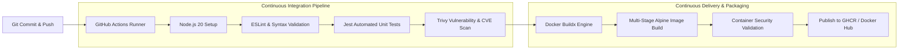

# CI/CD Container Pipeline & Automated Registry Deployment

[](LICENSE)
[](https://www.docker.com/)
[](ci/pipeline.yml)
[](https://trivy.dev/)

An enterprise-grade, production-ready continuous integration and continuous deployment (CI/CD) pipeline built with **GitHub Actions**, **Docker Buildx**, **Trivy Vulnerability Scanner**, and **GitHub Packages Container Registry (GHCR)**.

---

## 🏗️ Architecture & Pipeline Flow



---

## 🚀 Key DevOps Capabilities

1. **Multi-Stage Containerization (`Dockerfile`):**
   - Stage 1 (`builder`): Compiles source code, runs automated test suites, and generates production bundles.
   - Stage 2 (`runner`): Uses minimalist `node:20-alpine` base image, stripping out build tools and devDependencies for a minimal production image footprint.
   - Non-root user execution (`USER node`) to enforce principle of least privilege.
   - Built-in container health checks (`HEALTHCHECK`) for container orchestrators.

2. **Automated Quality & Test Gates:**
   - Pre-build linting and code validation.
   - Automated unit and integration testing via Jest with test coverage reports.

3. **Vulnerability & Container Security Scanning:**
   - Scans container base images and application dependencies for known CVEs using Aqua Security Trivy.
   - Fails builds if critical or high vulnerabilities are detected.

4. **Multi-Platform Build & Registry Publishing:**
   - Uses `docker/setup-buildx-action` with QEMU support for multi-platform compilation (`linux/amd64`, `linux/arm64`).
   - Automated semantic tagging (`latest`, git SHA tag, release tags).
   - Secure token-based authentication to GitHub Container Registry (`ghcr.io`).

---

## 📁 Repository Structure

```
.
├── Dockerfile                  # Multi-stage production container definition
├── docker-compose.yml          # Local multi-service orchestration & healthcheck
├── Makefile                    # Developer CLI commands (test, build, scan)
├── package.json                # Application metadata & test scripts
├── ci/
│   └── pipeline.yml            # Complete GitHub Actions CI/CD pipeline spec
├── src/
│   └── server.js               # Microservice with /health and /metrics endpoints
└── tests/
    └── server.test.js          # Automated unit test suite
```

---

## 🛠️ Local Developer Commands

```bash
# 1. Run automated unit test suite
npm test

# 2. Build local Docker container image
docker build -t cicd-pipeline-app:local .

# 3. Run container locally with health checks
docker-compose up -d

# 4. Check container health status
docker inspect --format='{{json .State.Health.Status}}' cicd-pipeline-app
```

---

## 👤 Author

**Mohammed Ibrahim**  
- GitHub: [@mohammedibrahim12](https://github.com/mohammedibrahim12)  
- LinkedIn: [mohammed-ibrahim-39385a395](https://www.linkedin.com/in/mohammed-ibrahim-39385a395)
